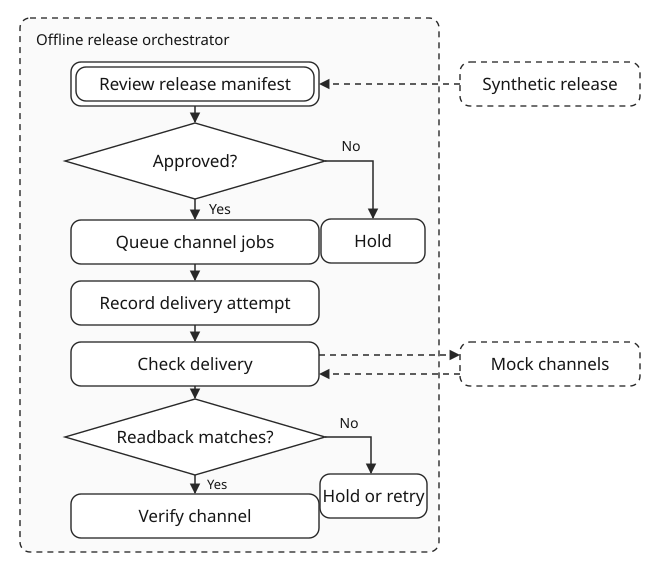

# Multichannel Release Orchestrator

An offline reference implementation for approving a release once and tracking a distinct payload and delivery state for each channel.



## Run

Use Python 3.10 or later. No third-party dependencies are required.

```sh
python orchestrator.py
python -m unittest -v
```

The scenario sends a fictional product release to mock storefront, newsletter and social channels. The storefront succeeds on the first run. The newsletter accepts its payload but loses the confirmation. The social channel remains unavailable before any write. After reopening both SQLite databases, the runner verifies the newsletter delivery and retries only social.

## State and recovery

- Approval binds the reviewer to a digest of the complete release manifest. The runner sends those exact channel payloads.
- Each channel has an independent attempt counter and stable delivery key. A database update claims the job before each attempt.
- Verified payloads complete their channel. A conflicting payload is held for intervention. A completed mock call with authoritative absence is retryable. An interrupted call with no readback remains unresolved.
- The first run binds the approved release to a persisted mock-provider identity. Reopening the same store preserves that identity. A replacement store or a legacy release with unbound attempts is rejected. Completed channel records are historical receipts.
- The release becomes complete after all channel deliveries are verified. The mock provides deterministic reads and idempotent writes; a live connector would need its own verification rules.

For an interrupted send, run again against the same store to reconcile matching evidence. Missing readback after an interruption leaves the job held. The mock's completed call with confirmed absence permits a retry. For an unresolved real delivery, use independent destination evidence and reconcile through a reviewed operator process. Retry only after confirming authoritative absence or a destination-supported idempotency guarantee. This demo provides no override for unresolved attempts.

The SQLite stores and caller-supplied reviewer name are trusted demo inputs. Reviewer names are unauthenticated.

[MIT License](LICENSE), copyright Nikita Khilko.
